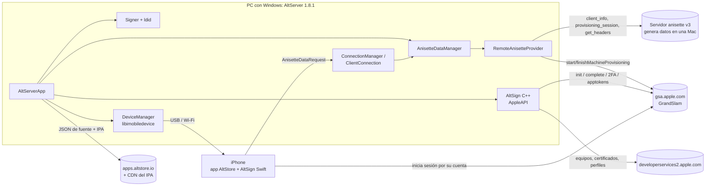
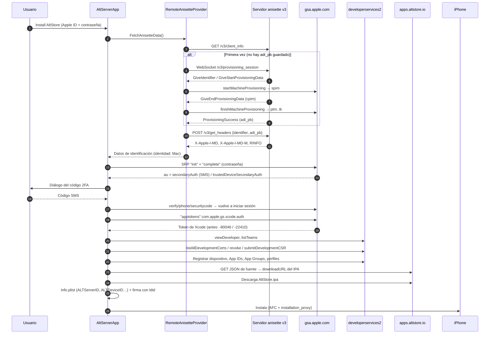
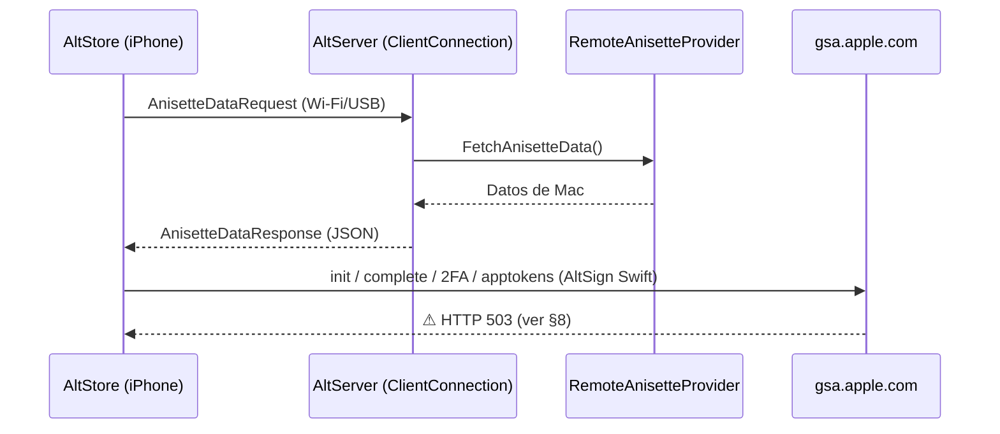

# AltServer para Windows 1.8.1: arquitectura, flujos y cómo se solucionó el -80046

- **Repositorio:** `charcsllc/AltServer-Windows`, rama `fix-80046`. Parte de `arm_1.7.5_jayce`, que es AltServer 1.7.5 de Riley Testut.
- **Release:** https://github.com/charcsllc/AltServer-Windows/releases/tag/v1.8.1. Lo compila y publica GitHub Actions en cada push.
- **Estado (28/10/2026):** AltServer en el PC **inicia sesión e instala AltStore correctamente**.
- **Pendiente:** la app AltStore del iPhone da **HTTP 503** al iniciar sesión (ver §8).

> Los diagramas están en Mermaid; GitHub los muestra como gráficos al abrir este archivo en la web.

---

## 1. Componentes

| Componente | Qué hace | Dónde está |
|---|---|---|
| **AltServerApp** | App de la bandeja de Windows: menús, instalación, diálogos, 2FA y descarga de AltStore | `AltServer/AltServerApp.cpp` |
| **AnisetteDataManager** | Entrega los "datos de identificación" (anisette). Ahora delega en RemoteAnisetteProvider; el camino de iCloud para Windows queda como respaldo | `AltServer/AnisetteDataManager.cpp` |
| **RemoteAnisetteProvider** *(nuevo)* | Cliente del protocolo **anisette v3**: registra el PC y obtiene datos de identificación de Mac | `AltServer/RemoteAnisetteProvider.{h,cpp}` |
| **AltSign (C++)** | API de Apple: inicio de sesión GrandSlam (SRP), 2FA, token de Xcode y servicios de desarrollador (equipos, certificados, dispositivos, App IDs, perfiles) | `AltSign/AppleAPI*.cpp` |
| **CertificateRequest / Certificate** | Genera la solicitud de certificado (CSR) y maneja .p12 con OpenSSL | `AltSign/CertificateRequest.cpp`, `AltSign/Certificate.cpp` |
| **Signer + ldid** | Firma el IPA con el certificado y el perfil | `AltSign/Signer.cpp`, `ldid/` |
| **DeviceManager** | Instala en el iPhone por USB o Wi-Fi con libimobiledevice (AFC + installation_proxy) | `AltServer/DeviceManager.cpp` |
| **ConnectionManager / ClientConnection** | Servidor al que se conecta la app AltStore del iPhone (Bonjour/mDNS y USB). Atiende `AnisetteDataRequest` e instalaciones | `AltServer/ConnectionManager.cpp`, `AltServer/ClientConnection.cpp` |
| **AltStore (iPhone) + AltSign Swift** | La app; inicia sesión **por su cuenta** con los datos de identificación que le da AltServer | `charcsllc/AltStore` y `charcsllc/AltSign` (rama `marketplace`) |

Servicios externos:
- **Servidores anisette v3**, en este orden: `mac-ani.jkcoxson.com`, `new.ani.sidestore.io`, `ani3.stikstore.app`.
- **Apple:** `gsa.apple.com` (inicio de sesión y registro del equipo) y `developerservices2.apple.com` (portal de desarrollador).
- **Fuente de AltStore:** `apps.altstore.io` (JSON con la URL del IPA).



---

## 2. Flujo completo de "Install AltStore" en el PC



Código clave de este flujo:

| Paso | Archivo:línea |
|---|---|
| Inicio de la instalación | `AltServer/AltServerApp.cpp:511` (`InstallApplication`) y `:595` (`_InstallApplication`) |
| Pide los datos de identificación | `AltServer/AltServerApp.cpp:611` → `AnisetteDataManager.cpp:364` → `RemoteAnisetteProvider.cpp:381` |
| Diálogo 2FA | `AltServer/AltServerApp.cpp:981` (`Authenticate`, `verificationHandler`) |
| SRP, 2FA y token | `AltSign/AppleAPI+Authentication.cpp:218` (`Authenticate`), `:669` (`apptokens`), `:864` (SMS), `:759` (dispositivo de confianza), `:988` (`SendAuthenticationRequest`) |
| Certificado | `AltServer/AltServerApp.cpp:1041` (`FetchCertificate`) → `AltSign/AppleAPI.cpp:311` (`AddCertificate`) → `AltSign/CertificateRequest.cpp` |
| Descarga de AltStore | `AltServer/AltServerApp.cpp:791` (`FetchAltStoreDownloadURL`) y `:946` (`DownloadApp`) |
| Info.plist de AltStore | `AltServer/AltServerApp.cpp:1619-1622` (`ALTDeviceID`, `ALTServerID`) |
| Instalación en el iPhone | `AltServer/DeviceManager.cpp:97` (`InstallApp`) |

---

## 3. Por qué fallaba: el -80046 (y el -22410)

Apple comprueba **qué tipo de equipo** inicia sesión, cruzando dos cosas:
- La **identidad declarada**, en el encabezado `X-Mme-Client-Info`.
- Los **datos de identificación** (anisette).

| Datos de identificación | Identidad declarada | Resultado |
|---|---|---|
| iCloud para Windows | Windows (AltServer oficial) | **-80046** en `apptokens`: desde el 22/10/2026 Apple no da el token de Xcode a un PC |
| iCloud para Windows | Mac | **-22410**: incoherente (Riley ya lo había cambiado en febrero de 2026, commit `e91915d`) |
| **Generados en una Mac** (anisette v3) | **Mac** | ✅ Funciona |

---

## 4. Cómo se solucionó (detalle técnico)

### 4.1 Datos de identificación de Mac remotos: `RemoteAnisetteProvider`
- **Servidores** (`RemoteAnisetteProvider.cpp:44`): se prueban en orden y se pasa al siguiente si uno falla. `ALTSERVER_ANISETTE_SERVER=<url>` fuerza uno concreto y `ALTSERVER_ANISETTE=local` vuelve a iCloud para Windows.
- **Estado persistente:** `C:\ProgramData\AltServer\Anisette.json` guarda:
  - `identifier`: 16 bytes aleatorios, en base64.
  - `deviceID`: UUID en mayúsculas.
  - `servers`: `{url: adi_pb}`.

  Si se borra el archivo, el PC se vuelve a registrar.
- **Datos que se construyen** (`AnisetteData`):
  - `machineID` = `X-Apple-I-MD-M` y `oneTimePassword` = `X-Apple-I-MD`.
  - `localUserID` = SHA-256 del identificador, en hexadecimal y mayúsculas.
  - `routingInfo` = `X-Apple-I-MD-RINFO`.
  - `deviceUniqueIdentifier` = `deviceID`, `deviceSerialNumber` = `"0"`.
  - `deviceDescription` = `client_info` del servidor (la identidad de Mac).
  - Configuración regional `en_US`, zona horaria `UTC`.
- **Registro del PC:** WebSocket con WinHTTP (`WinHttpWebSocketCompleteUpgrade`). Los datos `spim`/`cpim` se intercambian con Apple en `/grandslam/MidService/start|finishMachineProvisioning` (plist XML).
- **Reintento:** si `get_headers` no devuelve `"result": "Headers"`, se borra el `adi_pb` de ese servidor y se registra el PC de nuevo una vez.
- **iPhone:** `ClientConnection.cpp:176` (`ProcessAnisetteDataRequest`) entrega **los mismos datos de Mac** a la app.
- **Privacidad:** el servidor anisette **nunca** recibe el Apple ID, la contraseña ni los códigos 2FA.
- Se revirtió el primer intento (decir "Mac" solo en el token, commit `9dc3a9a`): ahora todo es coherente.

### 4.2 Error SSL `CERT_REV_FAILED` / `INVALID_CA`
- cpprestsdk **siempre exige comprobar la revocación** del certificado (`WINHTTP_ENABLE_SSL_REVOCATION` en `http_client_winhttp.cpp`), y en tu PC esa comprobación fallaba aunque Windows confiaba en el certificado. Lo demostró `Invoke-WebRequest`.
- **Solución** (`RemoteAnisetteProvider.cpp:121`, `SendHTTPRequest`): las peticiones a los servidores anisette usan **WinHTTP directamente**, con su validación estándar (autoridad, nombre y fecha, sin revocación).
- Para `gsa.apple.com` solo se ignora la autoridad (`SECURITY_FLAG_IGNORE_UNKNOWN_CA`), como ya hacía AltSign.

### 4.3 Cierre después del código SMS (`0xc0000005`, desplazamiento `0xeaf74`)
- Al desensamblar `AltServer.exe` se vio que el fallo estaba en `decompress()` (`AltSign/AppleAPI.cpp:62`). Usaba `web::http::compression::builtin::make_decompressor(GZIP)`, que es **nulo** cuando cpprestsdk se compila sin compresión, y AltSign lo usaba sin comprobarlo.
- **Solución:** descomprimir con **zlib** (`inflateInit2(&stream, 15 + 32)` detecta gzip o zlib).

### 4.4 "The certificate request is invalid."
- Con OpenSSL 3, `X509_REQ_set_version(request, 1)` falla: la única versión válida de una solicitud de certificado es **0**.
- **Solución** (`AltSign/CertificateRequest.cpp:85`): versión 0, y firma SHA-256 en lugar de SHA-1.

### 4.5 Compilación (GitHub Actions)
| Problema | Solución |
|---|---|
| El proyecto dependía del PC de Riley (rutas, Bonjour SDK, OpenSSL instalado, vcpkg) | Workflow `.github/workflows/build-windows.yml` en `windows-2025` (VS 2026, toolset v145) |
| cpprestsdk ya no existe en vcpkg | *Overlay port* copiado de vcpkg 2024.11.16 en `.github/vcpkg-ports/cpprestsdk/` |
| VS 2026 eliminó `stdext::checked_array_iterator` y `std::ios_base::_Openprot` | Parche `remove-removed-msvc-stl-extensions.patch` |
| OpenSSL 3 marca funciones como obsoletas y `/sdl` lo convierte en error | `Directory.Build.props` con `OPENSSL_SUPPRESS_DEPRECATED` |
| ldid buscaba OpenSSL 3 en `C:\Program Files (x86)\OpenSSL-3-Win32` | El workflow copia ahí el OpenSSL de vcpkg |
| La solución no declara las dependencias entre plist, usbmuxd e imobiledevice | Se compilan en orden (`/t:plist;usbmuxd;imobiledevice;AltServer`) |
| `Resource.rc` apuntaba a íconos en `C:\Users\Riley\…` | Rutas relativas (`..\Resources\Icon.ico`, `MenuBarIcon.ico`) |
| `regex2.dll` (GnuWin32) no está en el repositorio | El workflow la descarga |
| Bonjour SDK (`dns_sd.h`, `dnssd.lib`) | Port `mdnsresponder` de vcpkg |
| Dos ejecuciones publicaban el release a la vez | `concurrency` en el workflow |

Pasos del workflow: checkout con submódulos → código de libimobiledevice (`libimobiledevice-win32`, `msvc/master`) → `regex2.dll` → vcpkg (`cpprestsdk openssl zlib mdnsresponder dirent`, x86-windows, con caché) → OpenSSL para ldid → elegir toolset → `msbuild` Release/x86 → empaquetar (exe + DLL + runtime de C++) → artifact → release `v1.8.1` (prerelease).

### 4.6 Historial de commits (rama `fix-80046`)
```
71f032b Fixes certificate request generation with OpenSSL 3
d0f573a Decompresses Apple API responses with zlib directly
02fc467 Uses WinHTTP for anisette server and provisioning requests
942dfc0 Fetches Mac anisette data from anisette v3 servers
9dc3a9a Reverts claiming to be a Mac only for the Xcode auth token
c84b490 Uses relative icon paths in Resource.rc
862791f Patches cpprestsdk's use of std::ios_base::_Openprot
026655c Fixes OpenSSL 3 deprecation errors and libimobiledevice build order
bea2c19 Fixes cpprestsdk and ldid OpenSSL in Windows build workflow
affef52 Uses runner's vcpkg with cpprestsdk overlay port
7c037bd Adds GitHub Actions workflow to build AltServer for Windows
d6902eb Updates version to 1.8.1
```

---

## 5. Flujo de la app AltStore (iPhone)



La app inicia sesión con su **propio AltSign en Swift** (`AltSign/Sources/ALTAppleAPI+Authentication.swift`, en `charcsllc/AltSign`, rama `marketplace`). Por eso los arreglos de AltServer en C++ no le afectan, salvo los datos de identificación que recibe.

---

## 6. Dónde descarga AltServer el IPA de AltStore y cómo usar uno propio

**Código:** `AltServer/AltServerApp.cpp`
- **Líneas 72-82:** la fuente y el bundle ID.
  ```cpp
  #if STAGING
  std::wstring altstoreSourceURL = L"https://f000.backblazeb2.com/file/altstore-staging/apps-staging.json";
  #else
  std::wstring altstoreSourceURL = L"https://apps.altstore.io";
  #endif
  #if BETA
  std::wstring altstoreBundleID = L"com.rileytestut.AltStore.Beta";
  #else
  std::wstring altstoreBundleID = L"com.rileytestut.AltStore";
  #endif
  ```
- **Línea 791, `FetchAltStoreDownloadURL`:**
  1. Descarga el JSON de `altstoreSourceURL`.
  2. Busca en `apps[]` la app con `bundleIdentifier == altstoreBundleID`.
  3. De `versions[]`, elige la más reciente cuyo `minOSVersion` acepte el iPhone.
  4. Devuelve su `downloadURL`.
- **Línea 946, `DownloadApp`:** descarga ese `downloadURL` a un archivo temporal.
- Después, AltServer **vuelve a firmar** el IPA con tu certificado y añade `ALTServerID`/`ALTDeviceID` al Info.plist (líneas 1619-1622). Así que el IPA puede venir **sin firmar** o firmado con cualquier certificado.

### Opción A (la más simple): tu propio JSON de fuente
1. Sube tu IPA a un release, por ejemplo `https://github.com/charcsllc/AltStore/releases/download/v2.3.4/AltStore.ipa`.
2. Crea `altstore-source.json` en tu repositorio, por ejemplo en `charcsllc/AltServer-Windows`, rama `fix-80046`:
   ```json
   {
     "name": "AltStore (charcsllc)",
     "identifier": "com.charcsllc.altstore.source",
     "apps": [
       {
         "name": "AltStore",
         "bundleIdentifier": "com.rileytestut.AltStore",
         "developerName": "charcsllc",
         "versions": [
           {
             "version": "2.3.4",
             "date": "2026-10-28",
             "downloadURL": "https://github.com/charcsllc/AltStore/releases/download/v2.3.4/AltStore.ipa",
             "size": 0,
             "minOSVersion": "17.4"
           }
         ]
       }
     ]
   }
   ```
   La versión más reciente va primero. AltServer usa la primera compatible.
3. Cambia la línea 75:
   ```cpp
   std::wstring altstoreSourceURL = L"https://raw.githubusercontent.com/charcsllc/AltServer-Windows/fix-80046/altstore-source.json";
   ```
4. Haz push a `fix-80046`. El workflow recompila y publica el release.

### Opción B (más flexible): elegir la fuente sin recompilar
Leer una variable de entorno al principio de `FetchAltStoreDownloadURL` (línea 791):
```cpp
auto customSourceURL = std::getenv("ALTSERVER_ALTSTORE_SOURCE");
uri_builder builder(customSourceURL != nullptr ? WideStringFromString(customSourceURL) : altstoreSourceURL);
```
Luego, en Windows: `setx ALTSERVER_ALTSTORE_SOURCE https://raw.githubusercontent.com/.../altstore-source.json`, y reiniciar AltServer.

### Notas
- El **bundle ID** del IPA debe coincidir con `altstoreBundleID` (`com.rileytestut.AltStore`), o hay que cambiar la línea 81.
- **Compilar tu propio AltStore** (por ejemplo, con un AltSign corregido) requiere **macOS + Xcode**. Se puede hacer con GitHub Actions (`runs-on: macos-15`): `xcodebuild archive` sin firmar → empaquetar `Payload/AltStore.app` en un `.ipa`, y AltServer lo firma al instalar.
- Mientras tanto, **"Sideload .ipa…"** en el menú de AltServer instala cualquier IPA desde el PC.

---

## 7. Configuración y archivos en el PC
| Elemento | Ubicación o valor |
|---|---|
| Estado anisette | `C:\ProgramData\AltServer\Anisette.json` (borrar = volver a registrar el PC) |
| Certificados en caché | `C:\ProgramData\AltServer\Certificates\` |
| Otro servidor anisette | variable `ALTSERVER_ANISETTE_SERVER=https://…` |
| Volver a iCloud para Windows | variable `ALTSERVER_ANISETTE=local` |
| Actualizaciones automáticas (WinSparkle) | apuntan al AltServer oficial: **no aceptarlas** o se pierde este build |
| Registro de fallos | `Get-WinEvent` (Application Error), como se usó en §4.3 |

---

## 8. Pendiente: HTTP 503 al iniciar sesión en la app AltStore del iPhone

**Qué es:** el mensaje viene del AltSign en Swift de la app. Apple responde 503 en `gsa.apple.com`, el servidor de inicio de sesión. El código que lo detecta se añadió en septiembre de 2026 (AltSign PR #52, commit `1427cb1`), junto con el uso de una conexión nueva por petición (commit `023265c`). Así que tu AltStore probablemente ya incluye ese arreglo.

**Causas más probables, en orden:**
1. **Apple limitando los intentos.** Hoy hubo muchos inicios de sesión y 2FA con la misma cuenta. → **Espera unas horas** y prueba **una sola vez**. Muchos intentos seguidos alargan el bloqueo.
2. **Cambios de Apple** posteriores al 22/10 que afectan a cómo se identifica la app. Otras herramientas también reportan 503 desde entonces ("Apple's authentication servers returned an error (HTTP 503)"). Algunas lo solucionaron cambiando de servidor anisette (iPASide, SideStore "Reset adi.pb").
3. **Algo del AltSign en Swift que no coincide** con lo que espera Apple ahora.

**Qué hacer:**
- **Ya mismo:** usa AltServer en el PC para instalar y renovar. Funciona: "Install AltStore" o "Sideload .ipa", cada 7 días.
- **Para investigar:** en AltStore → Ajustes → "Error Log", exporta el detalle del 503 (qué petición falló).
- **Si no es el límite de intentos:**
  1. Aplicar en `charcsllc/AltSign` (rama `marketplace`, `ALTAppleAPI+Authentication.swift`) los mismos criterios que ya funcionan en el PC: identidad de Mac coherente y User-Agent `akd/1.0 CFNetwork/811.5.4 Darwin/16.7.0` del servidor anisette.
  2. Recompilar AltStore en GitHub Actions con macOS.
  3. Publicarlo en tu release e instalarlo con la opción A del §6.
